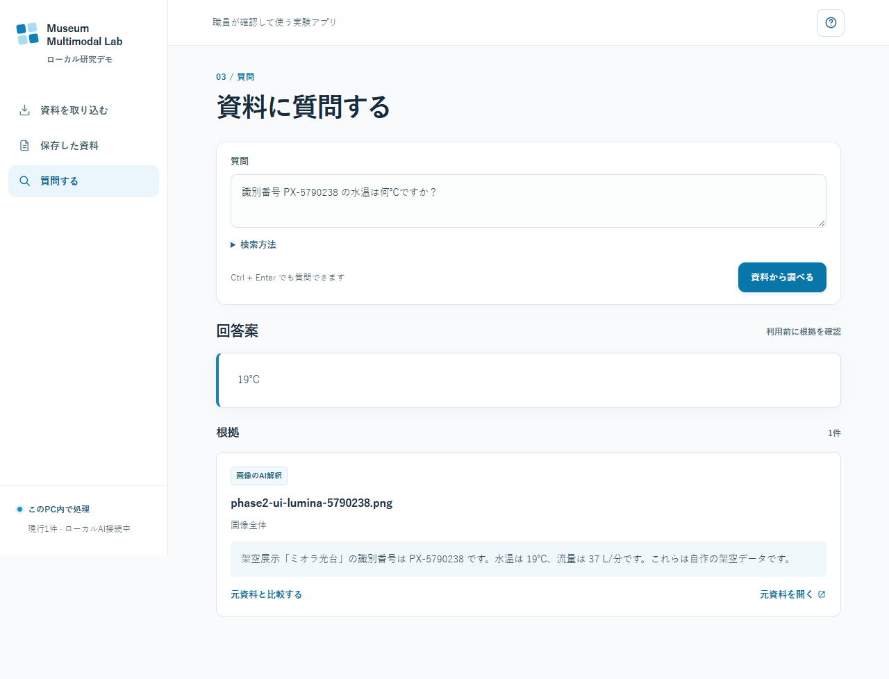

# Museum Multimodal Lab

PDF・画像・音声をローカルで読み取り、**人が原本と照合して登録した内容**から回答案と出典を返す、科学館での研究・説明活動向けのマルチモーダルRAGプロトタイプです。「取り込み → 確認・修正 → 登録 → 質問 → 原本確認」を一つのアプリで試せます。

図表の解釈や音声認識は数字・固有名詞を誤り得るため、人が承認するまで検索対象にしません。実際のデモはアプリ画面で行い、このGitHubはソースコードと設計判断を公開する技術ポートフォリオを兼ねます。実館での運用や有効性は実証していません。既存の [Museum Evidence Lab](https://github.com/yutoo77/museum-evidence-lab) とは独立したフォルダ・DB・ポートで動きます。

## 画面



自作の架空画像をローカルモデルで読み取り、テスト操作者が照合・修正して登録した後、**既定のBM25＋Qwen3 4B**で回答と出典を得た実画面です。Edge／Playwrightで撮影しました。Fake APIや手書きの回答は使っていません。

[取り込み](docs/portfolio/screenshots/release-import.png) · [原本を見ながら修正](docs/portfolio/screenshots/release-review-local.png) · [検索方法の選択](docs/portfolio/screenshots/release-retrieval-settings.png) · [出典と元資料を比較](docs/portfolio/screenshots/release-source-comparison.png)。

## 何ができるか

| 操作 | 利用者に見えること |
| --- | --- |
| 資料を取り込む | PDF、PNG/JPEG、短いWAVを画面から追加し、読み取りの工程と経過時間を確認する |
| 内容を確認する | 原本と抽出文を並べ、画像解釈・PDFの文字・音声認識の誤りを修正する |
| 知識に登録する | 明示的な確認後にだけ索引化し、未承認の資料を質問から除外する |
| 質問する | 複数の登録済み資料を検索し、ローカルLLMの回答案と出典を表示する |
| 原本へ戻る | 画像・PDFを拡大し、PDFの該当ページや音声の開始時刻と回答に使ったテキストを照合する |

```text
資料（PDF・画像・音声）
  → ローカル解析 → 原本との照合・修正 → 承認 → SQLiteへ索引化
  → 質問 → 検索（既定: BM25。ベクトル検索時はローカルQdrantも利用）
  → 承認済み本文を根拠にローカルLLMが回答案を作成
  → 出典ID・数値・版を検査 → 元資料で確認
```

機械抽出文と人の修正文を分け、資料版・ページ・時刻を持った出典を、回答を返す前に現行の原本・索引と照合します。確認・承認の手間は必要であり、出典や数値が検査を通ったことは回答の意味的な正しさを保証しません。

PDFの長文は段落・文末を優先して分割し、表画像の解釈文や短い音声発話は対応関係を壊さないよう原則そのまま扱います。異なる識別番号の資料が候補に並ぶなど、一部の曖昧な質問では回答を保留して聞き返します。

## 技術構成

| 領域 | 採用技術 |
| --- | --- |
| 画面・API | React / Vite / TypeScript、FastAPI / Python 3.11 |
| 保存・検索 | SQLiteを正本に、PythonのBM25、EmbeddingGemma、Qdrantの永続ローカルモード、順位融合（RRF） |
| 読み取り・生成 | PyMuPDF、ローカル画像対応Ollamaモデル、faster-whisper、ローカルOllama LLM |
| 視覚検索（任意） | 日本語CLIPのONNX版をCPUで実行し、画像・PDFページを直接検索 |
| 検証 | pytest、Ruff、TypeScript / ESLint / build、Playwright、隔離DBでの実モデルE2E |

データの流れ、API、資料・索引の状態遷移は [ARCHITECTURE.md](docs/ARCHITECTURE.md)、技術選定と採らなかった案は [DECISIONS.md](docs/DECISIONS.md) に記載しています。

## 検索方式

既定は **BM25** です。展示名・識別番号・数値を含む質問を扱いやすく、質問時に埋め込みモデルやQdrantを待たずに済みます。通常はそのまま質問でき、比較したいときだけ「検索方法」を開きます。資料の登録時には、他の検索方式でも使えるよう文字埋め込みを作ります。

| 方式 | 候補の探し方 |
| --- | --- |
| BM25（既定） | 日本語の文字2-gramと英数字の識別子による語句一致 |
| Legacy | 簡易語句検索とPythonの全件コサイン検索をRRFで統合 |
| Dense | EmbeddingGemmaとローカルQdrantで意味の近い確認済み本文を検索 |
| Text Hybrid | BM25とDenseの順位をRRFで統合 |
| Visual Retrieval（任意） | 日本語CLIPで画像・PDFページを直接検索 |
| Multimodal Hybrid（任意） | 文字Hybridと視覚検索を資料・ページ単位で統合 |
| Agentic Retrieval（実験的） | ローカルLLMが利用可能な検索方式を選び、必要なら1回だけ再検索 |

**画像を直接見つけることと、画像を読んで事実として回答することは別です。** 視覚検索からの回答も、原本に対応する**承認済みテキスト**を根拠にします。視覚モデルを準備しない場合、視覚2方式は選択肢に出ません。復元できない細かな図表の値やレイアウト、複数資料を横断する質問は取りこぼし得ます。Agenticによる精度・所要時間の改善は実証していません。

## 動かす

Windows 11、Python 3.11（64bit）、Node.js / npm、Ollamaと事前取得済みモデルが必要です。初回のパッケージ・モデル取得にはネット接続が必要な場合があります。**資料の推論時に外部AI APIへ送る経路は設けていません**が、ネットワーク遮断下の実行は未検証です。モデル名、インストール、起動トラブル対処は [セットアップ手順](docs/SETUP.md) を参照してください。

```powershell
py -3.11 -m venv .venv
.\.venv\Scripts\python.exe -m pip install --upgrade pip setuptools
.\.venv\Scripts\python.exe -m pip install -r requirements.txt
cd frontend
npm ci
cd ..
powershell.exe -NoProfile -ExecutionPolicy Bypass -File .\start_demo.ps1
# http://127.0.0.1:5174/
```

終了は `powershell.exe -NoProfile -ExecutionPolicy Bypass -File .\stop_demo.ps1`。起動スクリプトはこのアプリ専用の `127.0.0.1:11436`（Ollama）、`:8765`（API）、`:5174`（画面）を使い、ポートが埋まっていれば他のプロセスを停止せずに失敗します。GitHubのページからアプリが起動するわけではありません。

回答モデルの既定は `qwen3:4b-instruct-2507-q4_K_M` です。起動前に `$env:MML_ANSWER_MODEL = 'qwen3:1.7b'` を設定すると、待ち時間を抑えたい場合の軽量デモ構成に切り替えられます。[モデルの切り替えと任意の視覚検索モデルの準備](docs/SETUP.md)を参照してください。

## 架空資料で試す

実館資料・個人情報を使わず、[自作資料の生成と3〜5分のデモ手順](docs/DEMO_GUIDE.md)で試してください。表画像・文字PDF・短い日本語WAVをローカルの `data/demo/` に生成できます。画面は「資料を取り込む」「保存した資料」「質問する」の3つで、操作順は右上の「?」（使い方）からも確認できます。

1. 架空資料を取り込み、読み取り結果を原本と比較します。誤りは修正して保存します。
2. 確認チェックを入れて「知識に登録」します。抽出しただけでは質問対象になりません。
3. 資料固有の識別子・数値を質問し、回答案の出典から原本を開きます。資料外の質問では保留も確認します。

## 実際に確認した範囲

架空の表画像・文字PDF・短いWAVについて、公開版の隔離環境で原本確認まで検証しました。**WAVの元ASRは固有名詞・時刻を誤認し得るため、回答は照合・修正後の文字起こしに基づきます。** 実モデルとFake APIのテスト、確認範囲と限界は [TEST_REPORT.md](docs/TEST_REPORT.md) に分けて記録しています。

## 限界と安全上の境界

- 回答は原本を確認するための**案**です。モデルの読み違い、検索漏れ、出典と回答の意味的なずれは起こり得ます。曖昧さの検出にも見落としがあります。科学館職員・来館者による評価は未実施です。
- 単一の信頼できる利用者が操作するPC向けで、認証・複数端末運用・実館資料の保存方針はありません。`127.0.0.1`への制限は、OS全体の通信遮断や完全オフラインを証明しません。
- MP3/M4AはBackendでデコードとFake ASRへの受け渡しまで確認しましたが、現在の画面のファイル選択には表示せず、実ASR・耳での再生確認も未実施です。図表内の厳密な領域座標も取得しません。
- データはGit管理外の `data/` に保存します。Qdrantは派生索引で、回答には現行の承認済みデータだけを使います。古いベクトルの物理消去は遅れることがあり、機密データの消去手段ではありません。

次の課題は、未見資料での検索・保留の評価、職員による操作評価、ネットワーク遮断下での実行確認、MP3/M4Aの実ASR検証です。実館での資料保存や複数人利用は、その結果と運用要件を確認してから判断します。

検証日時・コマンド・失敗例・未確認項目は [TEST_REPORT.md](docs/TEST_REPORT.md)、訪問時の操作は [DEMO_GUIDE.md](docs/DEMO_GUIDE.md) を参照してください。

## ライセンス

Copyright (C) 2026 yutoo77。本リポジトリの自作物は、別記のない限り [GNU AGPL-3.0-only](LICENSE) で公開します。再利用・改変・再配布の際は同ライセンスの条件を確認してください。

PDF処理に利用する [PyMuPDF](https://pymupdf.io/licensing) はAGPLv3または商用ライセンスで提供されています。依存ライブラリ、任意のONNXモデル、第三者素材の扱いは [第三者ライセンス通知](THIRD_PARTY_NOTICES.md) を参照してください。本リポジトリに依存ライブラリ、モデル重み、第三者のバイナリは同梱しません。

パッケージの公開範囲は[公開時の確認事項](docs/portfolio/PUBLIC_AUDIT.md)に記載しています。
