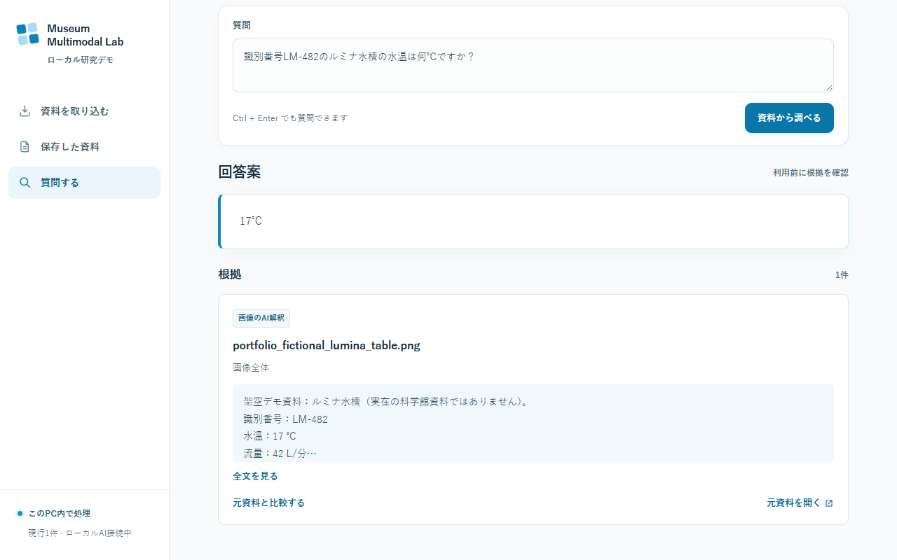

# Museum Multimodal Lab

PDF・画像・音声をローカルで読み取り、**人が原本と照合して登録した内容だけ**を後の質問に使う、科学館向けの研究用RAGデモです。回答には元資料へ戻れる出典を付けます。画像を一度説明するだけでなく、「取り込み → 確認・修正 → 登録 → 別の質問 → 原本確認」を一つのアプリで試せます。

科学館職員との相談で「どの資料や業務に役立つか」を検討するために作りました。図表や音声は文字PDFの検索だけでは扱えず、AIの読み違いをそのまま「根拠」にもできません。そのため、形式ごとの読み取りを**人が確認したテキスト**へ集約します。実館での運用やモデル精度を実証した製品ではありません。既存の [Museum Evidence Lab](https://github.com/yutoo77/museum-evidence-lab) とは独立したフォルダ・DB・ポートで動きます。

## 画面



実Edge / Playwrightで撮った、**自作の架空画像をローカル画像モデルで読み取り、人が原本と照合・修正・登録した後、実Ollama埋め込み検索と実Ollama LLMで回答した画面**です。FastAPI/Reactの実動作で、回答本文や出典はFake API・手書き画像ではありません。原本の17℃と回答・出典の対応をこの少数例で確認しました。これは一般的な精度の証明ではありません。

[取り込み](docs/portfolio/screenshots/import-real-ollama.png) · [自動抽出の確認](docs/portfolio/screenshots/review-raw-real-ollama.png) · [人が修正した内容](docs/portfolio/screenshots/review-corrected-real-ollama.png) · [元資料との比較](docs/portfolio/screenshots/source-comparison-real-ollama.png) · [原本を拡大](docs/portfolio/screenshots/source-zoom-real-ollama.png)。撮影条件・試行回数・変更前後の判断は[画面記録](docs/portfolio/UI_REVIEW.md)と[検証記録](docs/TEST_REPORT.md)に記載しています。以前のFake API画像も比較用に残し、実モデルの証拠とは呼びません。

## 何ができるか

| 操作 | 利用者に見えること |
| --- | --- |
| 資料を取り込む | PDF、PNG/JPEG、短いWAVを画面から追加し、読み取りの工程と経過時間を確認する |
| 内容を確認する | 原本と抽出文を並べ、画像解釈・PDFの文字・音声認識の誤りを修正する |
| 知識に登録する | 明示的な確認後にだけ索引化し、未承認の資料を質問から除外する |
| 質問する | 複数の登録済み資料を検索し、ローカルLLMの回答案と出典を表示する |
| 原本へ戻る | 画像・PDFを拡大し、PDFの該当ページや音声の開始時刻と回答に使ったテキストを照合する |

```text
資料（PDF・画像・音声）
  → ローカル解析 → 原本との照合・修正 → 承認 → SQLiteへ保存・索引化
  → 質問 → 語句検索＋埋め込み検索 → ローカルLLMの回答案
  → 出典IDを検査 → 元資料で確認
```

技術的な要点は、(1) **承認前に検索しない**こと、(2) 機械抽出文と人の修正文、資料版・ページ・時刻の**来歴を分けて残す**こと、(3) 語句検索とローカル埋め込み検索をRRFで統合し、回答の出典ID・数値・索引の鮮度を**返却前に確認する**ことです。出典や数値の検査は、回答の意味的な正しさの証明ではありません。人手確認は誤読の混入を減らす一方、資料ごとに照合・修正する負担があり、承認だけで正確性は保証されません。

PDFの長文は段落・文末を優先して重なりを持たせて分け、同じ抽出単位の離れた根拠も最大2箇所まで取得します。一方、表画像の解釈文や短い音声発話は対応関係と元の位置を壊さないよう原則そのまま扱います。近い資料が複数あり、本文中の異なる識別番号まで確認できる曖昧な質問では、LLMに一つを選ばせず候補資料を提示します。これは限定的な安全策で、すべての曖昧さを検出しません。単一PCでの小規模デモなので、DBはSQLiteに留め、専用ベクトルDBを必須にしていません。

## 技術構成

| 領域 | 採用技術 |
| --- | --- |
| 画面・API | React / Vite / TypeScript、FastAPI / Python 3.11 |
| 保存・検索 | SQLite、ローカル埋め込み、語句検索＋Dense検索＋RRF |
| 読み取り・生成 | PyMuPDF、ローカル画像対応Ollamaモデル、faster-whisper、ローカルOllama LLM |
| 検証 | pytest、Ruff、TypeScript / ESLint / build、Playwright、隔離DBでの実モデルE2E |

データの流れ、API、資料・索引の状態遷移は [ARCHITECTURE.md](docs/ARCHITECTURE.md)、技術選定と採らなかった案は [DECISIONS.md](docs/DECISIONS.md) に記載しています。

## 動かす

Windows 11、Python 3.11（64bit）、Node.js / npm、Ollamaと事前取得済みモデルが必要です。初回のパッケージ・モデル取得にはネット接続が必要な場合があります。**資料の推論時に外部AI APIへ送る経路は設けていません**が、ネットワーク遮断下の実行は未検証です。モデル名、インストール、起動トラブル対処は [セットアップ手順](docs/SETUP.md) を参照してください。

```powershell
py -3.11 -m venv .venv
.\.venv\Scripts\python.exe -m pip install --upgrade pip setuptools
.\.venv\Scripts\python.exe -m pip install -r requirements.txt
cd frontend
npm ci
cd ..
powershell.exe -NoProfile -ExecutionPolicy Bypass -File .\start_demo.ps1
# http://127.0.0.1:5174/
```

終了は `powershell.exe -NoProfile -ExecutionPolicy Bypass -File .\stop_demo.ps1`。起動スクリプトはこのアプリ専用の `127.0.0.1:11436`（Ollama）、`:8765`（API）、`:5174`（画面）を使い、ポートが埋まっていれば他のプロセスを停止せずに失敗します。GitHubのページからアプリが起動するわけではありません。

## 架空資料で試す

実館資料・個人情報を使わず、[自作資料の生成と3〜5分のデモ手順](docs/DEMO_GUIDE.md)で試してください。表画像・文字PDF・短い日本語WAVをローカルの `data/demo/` に生成できます。画面は「資料を取り込む」「保存した資料」「質問する」の3つで、操作順は右上の「?」（使い方）からも確認できます。

1. 架空資料を取り込み、読み取り結果を原本と比較します。誤りは修正して保存します。
2. 確認チェックを入れて「知識に登録」します。抽出しただけでは質問対象になりません。
3. 資料固有の識別子・数値を質問し、回答案の出典から原本を開きます。資料外の質問では保留も確認します。

## 実際に確認した範囲

自作の表画像、文字PDF、画像のみPDF、短いWAVで、隔離DBと実ローカルモデルを使った抽出・テスト操作者による修正・登録・後からの質問・原本出典の一往復を確認しています。最新画面でも空の隔離DBから画像の一往復を再実行し、実回答と原本を撮影しました。似た架空資料3件を識別子ごとに引き分けられるか、曖昧な質問で候補を返せるか、承認前の保留、差し替え・削除・再起動も少数例で試しました。**WAVの元ASRは固有名詞と時刻を誤認し、正しい回答は人が修正した文字起こしに基づきます。** 実モデルの結果とFake APIのUIテストは区別して [TEST_REPORT.md](docs/TEST_REPORT.md) に記録しています。

## 限界と安全上の境界

- 回答は原本を確認するための**案**です。モデルの読み違い、検索漏れ、出典と回答の意味的なずれは起こり得ます。曖昧さの検出にも見落としがあります。科学館職員・来館者による評価は未実施です。
- 単一の信頼できる利用者が操作するPC向けで、認証・複数端末運用・実館資料の保存方針はありません。`127.0.0.1`への制限は、OS全体の通信遮断や完全オフラインを証明しません。
- MP3/M4AはBackendでデコードとFake ASRへの受け渡しまで確認しましたが、現在の画面のファイル選択には表示せず、実ASR・耳での再生確認も未実施です。図表内の厳密な領域座標も取得しません。
- データはGit管理外の `data/` に保存します。原本・DB・ログ・モデルをGitHubへ含めないでください。既存資料に新しいChunk分割を適用するには、資料ごとの明示的な再索引が必要です。

次の課題は、未見資料での検索・保留の評価、職員による操作評価、ネットワーク遮断下での実行確認、MP3/M4Aの実ASR検証です。実館での資料保存や複数人利用は、その結果と運用要件を確認してから判断します。

検証日時・コマンド・失敗例・未確認項目は [TEST_REPORT.md](docs/TEST_REPORT.md)、訪問時の操作は [DEMO_GUIDE.md](docs/DEMO_GUIDE.md) を参照してください。

## ライセンス

Copyright (C) 2026 yutoo77。本リポジトリの自作物は、別記のない限り [GNU AGPL-3.0-only](LICENSE) で公開します。再利用・改変・再配布の際は同ライセンスの条件を確認してください。

PDF処理に利用する [PyMuPDF](https://pymupdf.io/licensing) はAGPLv3または商用ライセンスで提供されています。PyMuPDFを含む依存ライブラリの著作権・ライセンス表示はそれぞれの条件に従い尊重してください。本リポジトリに依存ライブラリやモデル重みは同梱しません。

公開用候補の監査範囲は[公開前監査](docs/portfolio/PUBLIC_AUDIT.md)に記録しています。GitHubでのPublic化は利用者の最終確認後に行います。
