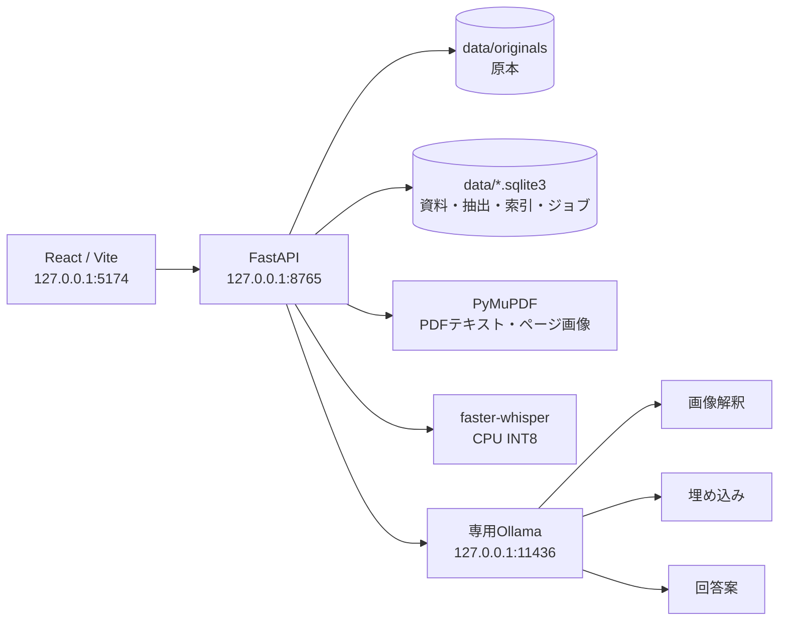
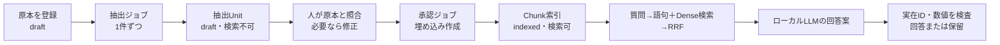

# 構成とデータの流れ

この文書は**現在の実装**を記します。構想中の音声出力、アバター、来館者向け自動応答、複数端末配布は含みません。既存 Museum Evidence Lab は参照のみで、このアプリの実行先・DB・ポートとは独立しています。

Frontendは`/api`をViteのローカルプロキシ経由でBackendへ送ります。通常は5174→8765番で、隔離テスト時のみ許可したloopbackポートへ切り替えます。SQLiteのパスやモデル重みをブラウザーへ公開せず、元ファイルは資料IDを指定するAPIを通して閲覧します。PDFページの画面内プレビューは、Backendが指定ページをPyMuPDFでローカル描画したPNGです。元PDFを開く導線も別に残します。起動スクリプトは専用Ollamaを11436番で立ち上げ、既存の11434/11435番やそのプロセスを停止しません。認証はなく、**信頼できる人が使う単一PCのデモ**に限ります。

## 一往復の状態遷移

抽出と索引化は同じプロセス内の`ThreadPoolExecutor(max_workers=1)`で順に実行します。質問とジョブのモデル呼び出しもBackend内のロックで直列化します。専用Ollamaは最大ロードモデル数1・並列数1・`keep_alive=0`を使用します。起動スクリプトは専用Ollama用に変更した環境変数を起動処理後に復元します。HTTP受付はジョブIDを返し、画面が`GET /api/jobs/{id}`をポーリングします。応答の`phase`と`elapsed_sec`は実際のジョブ状態・開始時刻から求め、残り時間を予測しません。ジョブ状態はSQLiteに保存し、実行途中のアプリ再起動では未完了ジョブを失敗に変え、その理由を資料にも残します。旧い確定索引を先に消さず、途中から自動再開したふりもしません。

`Document`の状態は`draft`（登録・抽出後の確認待ち）、`reviewed`（確認操作後、初回索引化処理中/失敗時）、`indexed`（検索可）、`failed`（初回抽出失敗）、`superseded`（同名の新版が登録された旧版）です。`Job`には別に`pending / running / completed / failed`を持ちます。**再解析**は既存の確認済みUnit/Chunkを処理中に維持し、抽出成功時だけ新Unitへの入れ替えと旧Chunk無効化を一つのDBトランザクションで行います。抽出失敗や途中再起動なら旧版の回答は残り、ジョブ失敗と資料エラーを表示します。**Unit本文の直接編集**は旧Chunkを即時無効化し、再承認まで検索不可です。**再索引**も新しい埋め込みを作成してから置き換え、失敗時は旧索引を維持します。ただしモデル不一致なら旧索引を使った質問は保留です。同名資料の新版をアップロードすると旧版のChunkを削除して`superseded`にし、旧出典が検索に残らないようにします。処理中の同名資料は差し替えを拒否します。

## 保存するものと来歴

| 対象 | 主な内容 | 注意 |
| --- | --- | --- |
| `documents` | UUID、表示名、元ファイルのSHA256・保存名、形式、版、状態、抽出モデル名、日時 | 表示名と実際の保存ファイル名は別。原本は`data/originals/<UUID>.<ext>` |
| `extracted_units` | 種別、抽出時の文字列、人の修正文字列、ページまたは開始・終了秒、モデル名 | `pdf_text`だけがPDFテキスト層由来。`image_interpretation`はモデルの解釈、`audio_transcript`はASRの推定 |
| `review_events` | 修正前後のテキスト、修正・承認の操作時刻 | 追加の履歴表。元の機械抽出文は`extracted_units.extracted_text`に保持 |
| `chunks` | 承認後の検索・出典テキスト、Unit/Document ID、Unit内順序、埋め込みと次元・モデル名、索引版 | 修正があれば修正後を使用。承認前は作成しない。モデル・ベクトル次元不一致なら質問を保留し再索引が必要 |
| `jobs` | 種別、状態、エラー、開始・終了時刻 | 長い抽出・埋め込み中も工程名と経過時間を取得できる |

SQLiteは`data/museum_multimodal_lab.sqlite3`です。原本・DB・ログはすべてGit管理外。機密資料を使う段階では端末のアクセス制御・バックアップ・削除方針が別途必要です。同名更新した旧版の原本とDB行はローカルに保持され、一覧では「旧版」として閲覧・削除できますが、検索・再編集・再承認には使えません。これを長期保存の運用設計とみなさないでください。

PDFはテキスト層を先に抽出し、画像や図形を含むページ、または文字のないページを画像モデルへ送ります。最大3ページまでです。画像モデル用のPDFページ画像は、巨大なページでも描画前に長辺1280ピクセル以下へ縮小率を決め、ラスタライズ時のメモリ負荷を抑えます。テキストのみのページと画像解釈が同じページに並ぶことがあります。表構造は画像モデルへ行列・単位の保持を指示しますが、**構造化表の決定的なパーサーは未実装**で、出力を人が照合します。図表の厳密な領域座標は取得しておらず、`bbox_json`は現状未利用です。画像は全体、PDFは該当ページへ戻れますが、ページ内の図表位置へ精密にジャンプする機能ではありません。音声はセグメントごとの時刻とテキストを保持し、後から元音声へ戻る導線を作ります。

## 検索と回答の境界

確認済みUnitから索引を作るとき、`retrieval.chunk_text()`は資料の種類で分け方を変えます。`pdf_text`は1ページの文章を最大約1000文字、前後120文字の重なりで分割し、段落・文末を優先します。長い`audio_transcript`は最大約1600文字・120文字の重なりで分けますが、各Chunkの出典は**元ASRセグメント全体の開始・終了時刻**です。分割後の文ごとに精密な時刻を推定したものではありません。短い音声Unitと`image_interpretation`は原則1Chunkに保ち、表の行・列・数値・単位の構造を文字数だけで分断しません。1000/1600文字はこのデモの説明可能な初期値で、精度・速度の最適値を実測した結果ではありません。

RRF後の選択では、同じUnitから最大2Chunkを許します。1件目はRRF上位、2件目は質問語のうち1件目にない語を多く含む候補を優先し、同点ならRRF順にします。空白・句読点の違いだけの同一本文は重複を抑えますが、異なる数値や識別子を含む本文を曖昧な類似度で捨てません。これにより同じPDFページの離れた2箇所を回答に渡せます。一方、3箇所以上が同時に必要な質問や、複数の識別子が別々のChunkに分かれる質問は取りこぼし得ます。MMRは導入せず、既存のRRF・関連性ゲート・最大5件を維持します。語句検索もBM25ではなく簡易スコアのままです。長い画像解釈は表を推測で分断せず1Chunkに保ちますが、現状は1Chunkが8000文字を超えると登録できず、回答へ渡す根拠テキストも先頭3000文字までです。後半情報の回答性は未解決です。

検索候補の選択変更は既存索引にも適用されますが、既存のChunk本文やベクトルはコード更新だけでは書き換わりません。新しい分割を**既存資料**に反映するには、資料詳細から1件ずつ「検索情報を更新」（`POST /api/documents/{id}/reindex`）が必要です。今回の改修では通常DBへの再索引を実行しません。再索引はEmbeddingを先に作り、成功時だけ旧Chunkを置き換えます。途中失敗なら旧索引を維持しますが、埋め込みモデル不一致中の質問は従来どおり保留します。Chunk数が増える資料では索引作成時間・保存量が増えます。

承認済みChunkに対して、NFKC正規化後の英数字語・日本語2-gramによる語句スコアと、`embeddinggemma`のコサイン類似度を計算し、RRFで統合します。現在は小規模資料を想定したPython側の全件計算です。関連性ゲートはヒューリスティックで、誤検索と過剰保留の双方を起こし得ます。質問に識別子があるときは、候補テキストとの一致も要求します。

LLMに渡すのは検索された確認済みテキストと仮の`S1`等のIDです。LLMが返す回答と出典IDをBackendで解析し、候補外ID・空回答・引用にない数値は保留します。埋め込みモデル・次元が保存索引と一致しない場合も、旧ベクトルを黙って混ぜず保留し、再索引を求めます。出典を返す直前に、参照Chunkの索引版・本文・関連Unit/Document状態・原本の有無をDB/ファイルで再確認します。生成中に編集・削除・同名差替えが起きて古くなった場合は保留します。これは最後の検査であり、読み取りと応答送信を一つの原子的処理にする保証ではありません。画面の出典はDB内のChunk/Unit/Documentから再構成し、PDFページや音声時刻を原本URLのフラグメントへ付けます。これは**根拠候補を追跡できる設計**であって、画像の読取や回答の意味的正しさを証明しません。スタッフの原本確認を省略しないでください。

## API

| 操作 | エンドポイント | 主な結果 |
| --- | --- | --- |
| 状態 | `GET /api/health` | DB件数、Ollama到達、設定モデル・導入済みモデル |
| 登録 | `POST /api/documents` | 形式・サイズ検査後、原本と`draft`資料 |
| 抽出 | `POST /api/documents/{id}/extract` | 202、`job_id` |
| ジョブ | `GET /api/jobs/{id}` | 実工程、経過時間、失敗理由、処理時間 |
| 一覧・詳細・原本 | `GET /api/documents`、`GET /api/documents/{id}`、`GET /api/documents/{id}/original` | 資料/Unit、原本有無・PDFページ数・再索引要否、原本ストリーム |
| PDFプレビュー | `GET /api/documents/{id}/pages/{page_number}/preview` | 指定ページの表示用画像 |
| 修正 | `PATCH /api/extracted-units/{id}` | 修正後Unit。索引があれば無効化 |
| 承認・索引化 | `POST /api/documents/{id}/approve` | 202、`job_id` |
| 再索引 | `POST /api/documents/{id}/reindex` | 確認済みUnitから新Embeddingを作り、成功時だけ旧索引と置換するジョブ。モデル不一致中の質問は保留 |
| 削除 | `DELETE /api/documents/{id}` | DBと原本の削除。実行中ジョブの資料は拒否 |
| 質問 | `POST /api/ask` | `answered`または`held`、回答案、実在出典IDに結びつくカード情報 |

主要実装は`backend/museum_multimodal_lab/`にあり、`api.py`がHTTP、`service.py`が状態遷移・ジョブ・索引、`extraction.py`が形式別抽出、`providers.py`がローカルモデル接続、`retrieval.py`が検索、`db.py`がスキーマを担当します。`frontend/src/`はUI/APIクライアントです。
