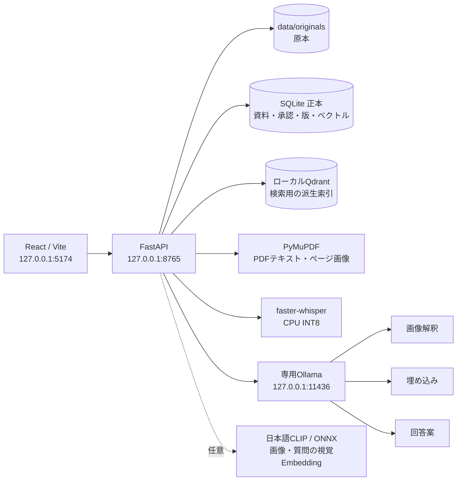
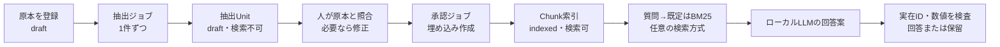

# 構成とデータの流れ

この文書は**現在の実装**を記します。構想中の音声出力、アバター、来館者向け自動応答、複数端末配布は含みません。既存 Museum Evidence Lab は参照のみで、このアプリの実行先・DB・ポートとは独立しています。

Frontendは`/api`をViteのローカルプロキシ経由でBackendへ送ります。通常は5174→8765番で、隔離テスト時のみ許可したloopbackポートへ切り替えます。SQLiteのパスやモデル重みをブラウザーへ公開せず、元ファイルは資料IDを指定するAPIを通して閲覧します。PDFページの画面内プレビューは、Backendが指定ページをPyMuPDFでローカル描画したPNGです。元PDFを開く導線も別に残します。起動スクリプトは専用Ollamaを11436番で立ち上げ、既存の11434/11435番やそのプロセスを停止しません。認証はなく、**信頼できる人が使う単一PCのデモ**に限ります。

## 一往復の状態遷移

抽出と索引化は同じプロセス内の`ThreadPoolExecutor(max_workers=1)`で順に実行します。質問とジョブのモデル呼び出しもBackend内のロックで直列化します。専用Ollamaは最大ロードモデル数1・並列数1・`keep_alive=0`を使用します。起動スクリプトは専用Ollama用に変更した環境変数を起動処理後に復元します。HTTP受付はジョブIDを返し、画面が`GET /api/jobs/{id}`をポーリングします。応答の`phase`と`elapsed_sec`は実際のジョブ状態・開始時刻から求め、残り時間を予測しません。ジョブ状態はSQLiteに保存し、実行途中のアプリ再起動では未完了ジョブを失敗に変え、その理由を資料にも残します。旧い確定索引を先に消さず、途中から自動再開したふりもしません。

`Document`の状態は`draft`（確認待ち）、`reviewed`（確認操作後、初回索引化中または失敗）、`indexed`（検索可）、`failed`（初回抽出失敗）、`superseded`（同名の新版が登録された旧版）です。**再解析**は成功時に限り、新Unitへの入れ替えと旧Chunkの無効化を一つのSQLiteトランザクションで行います。**Unit本文の編集**は旧Chunkを即時無効化し、再承認まで検索不可です。**再索引**も準備成功時だけSQLiteの旧索引を置き換えます。同名資料の新版が登録されたときは旧版を`superseded`にして旧Chunkを無効化します。処理中の同名資料は差し替えを拒否します。

## 保存するものと来歴

| 対象 | 主な内容 | 注意 |
| --- | --- | --- |
| `documents` | UUID、表示名、元ファイルのSHA256・保存名、形式、版、状態、抽出モデル名、日時 | 表示名と実際の保存ファイル名は別。原本は`data/originals/<UUID>.<ext>` |
| `extracted_units` | 種別、抽出時の文字列、人の修正文字列、ページまたは開始・終了秒、モデル名 | `pdf_text`だけがPDFテキスト層由来。`image_interpretation`はモデルの解釈、`audio_transcript`はASRの推定 |
| `review_events` | 修正前後のテキスト、修正・承認の操作時刻 | 追加の履歴表。元の機械抽出文は`extracted_units.extracted_text`に保持 |
| `chunks` | 承認後の検索・出典テキスト、Unit/Document ID、Unit内順序、文字埋め込み・モデル・次元、索引版 | 修正済み本文を優先。承認前は作成しない |
| `visual_pages`（任意） | 承認済み原本の画像・PDFページの視覚埋め込み、モデル・次元 | ページ内の代表Chunkに関連付ける。文字ベクトルと混ぜない |
| `jobs` | 種別、状態、エラー、開始・終了時刻 | 長い抽出・埋め込み中も工程名と経過時間を取得できる |

SQLiteは`data/museum_multimodal_lab.sqlite3`です。原本・DB・ログはすべてGit管理外。機密資料を使う段階では端末のアクセス制御・バックアップ・削除方針が別途必要です。同名更新した旧版の原本とDB行はローカルに保持され、一覧では「旧版」として閲覧・削除できますが、検索・再編集・再承認には使えません。これを長期保存の運用設計とみなさないでください。

PDFはテキスト層を先に抽出し、画像や図形を含むページ、または文字のないページを画像モデルへ送ります。最大3ページまでです。画像モデル用のPDFページ画像は、巨大なページでも描画前に長辺1280ピクセル以下へ縮小率を決め、ラスタライズ時のメモリ負荷を抑えます。テキストのみのページと画像解釈が同じページに並ぶことがあります。表構造は画像モデルへ行列・単位の保持を指示しますが、**構造化表の決定的なパーサーは未実装**で、出力を人が照合します。図表の厳密な領域座標は取得しておらず、`bbox_json`は現状未利用です。画像は全体、PDFは該当ページへ戻れますが、ページ内の図表位置へ精密にジャンプする機能ではありません。音声はセグメントごとの時刻とテキストを保持し、後から元音声へ戻る導線を作ります。

## 検索と回答の境界

確認済みUnitから索引を作るとき、`retrieval.chunk_text()`は資料の種類で分け方を変えます。`pdf_text`は1ページの文章を最大約1000文字、前後120文字の重なりで分割し、段落・文末を優先します。長い`audio_transcript`は最大約1600文字・120文字の重なりで分けますが、各Chunkの出典は**元ASRセグメント全体の開始・終了時刻**です。分割後の文ごとに精密な時刻を推定したものではありません。短い音声Unitと`image_interpretation`は原則1Chunkに保ち、表の行・列・数値・単位の構造を文字数だけで分断しません。1000/1600文字はこのデモの説明可能な初期値で、精度・速度の最適値を実測した結果ではありません。

文字検索の候補選択では、空白・句読点の差だけの重複を抑え、同じUnitから最大2Chunk、全体で最大5件を取り出します。順位だけでなく質問語をどれだけ補えるかを選択に使います。複数の識別子が別々の資料・Chunkにある場合や、多数の根拠が同時に必要な場合は取りこぼし得ます。長い画像解釈は表を推測で分割せず、1Chunkが8000文字を超えると登録できません。回答に渡す根拠テキストも先頭3000文字までです。

検索方式を切り替えても既存のChunkや埋め込みは書き換わりません。埋め込みモデルの変更や、承認済み資料へ後から視覚索引を足す場合は、資料詳細から「検索情報を更新」（`POST /api/documents/{id}/reindex`）を実行します。

BM25は、NFKC正規化した日本語の文字2-gramと英数字トークンを使ってSQLiteの現行Chunkを順位付けします。Legacyは簡易語句スコアとPythonの全件コサイン検索、DenseはEmbeddingGemmaとQdrantローカル索引です。文字HybridはBM25とDenseをRRFで統合します。Denseのコサイン下限は通常0.72、質問の識別番号と主題語が候補に一致したときだけ0.45。正答確率ではなく、取りこぼしと誤検索の両方があり得る候補除外条件です。

視覚Retrievalは日本語CLIPのONNX版で、質問と原本画像／PDFページを同じ視覚Embedding空間に写します。PDFの文字埋め込みとは別空間です。視覚候補を現行ページの承認済み本文へ対応付け、文字と画像を併用するときは資料・ページ単位のRRFで融合します。個々の文字・レイアウトの厳密な認識や音声そのものの視覚検索は行いません。任意の画像再照合も、同じ資料内の確認済み抜粋の選択に限り、未承認の画像解釈を根拠へ追加しません。

QdrantはSQLiteの現行・承認済みデータから照合される**派生索引**です。テキストと視覚を別コレクションにし、版・モデル・次元を照合します。回答用本文をQdrantのペイロードから採用しません。SQLiteの更新とQdrantの物理更新は単一トランザクションではなく、古い点や使われなくなった旧モデルのコレクションが残り得ます。Qdrantを必要とする固定方式の障害はエラーとし、不完全な候補を正常扱いしません。BM25はQdrantを使わず、質問を埋め込みません。モデル・次元不一致の古いベクトルで検索することはせず、再索引を促します。

Agenticでは、ローカルLLMの計画を許可リストと形式で検証し、検索方式の選択と元の固有識別子・数値を保った言い換えに限定します。再検索は最大1回。時間上限を扱い、不正な計画・不足時は固定検索へのフォールバックまたは保留にします。原本編集、任意コマンド、外部通信のツールはありません。ネイティブ処理まで強制終了する期限ではありません。

LLMに渡すのは承認済みテキストと仮の`S1`等のIDです。候補外の出典ID・空回答・引用にない数値などは保留にし、一部の曖昧な質問では確認を促します。回答を返す直前に、**引用した箇所だけでなく生成に渡した全Chunk**の版・本文・承認状態・原本との整合性を再確認します。途中で変更・削除され古くなった場合は保留します。読み取りと応答送信を原子化する保証ではありません。出典はSQLiteから再構成し、PDFページや音声時刻に戻るリンクを付けます。これは根拠を追跡する設計であり、回答の意味的な正しさを証明するものではありません。

## API

| 操作 | エンドポイント | 主な結果 |
| --- | --- | --- |
| 状態 | `GET /api/health` | DB件数、Ollama、設定モデル、利用可能な検索方式・視覚索引の状態 |
| 登録 | `POST /api/documents` | 形式・サイズ検査後、原本と`draft`資料 |
| 抽出 | `POST /api/documents/{id}/extract` | 202、`job_id` |
| ジョブ | `GET /api/jobs/{id}` | 実工程、経過時間、失敗理由、処理時間 |
| 一覧・詳細・原本 | `GET /api/documents`、`GET /api/documents/{id}`、`GET /api/documents/{id}/original` | 資料/Unit、原本有無・PDFページ数・再索引要否、原本ストリーム |
| PDFプレビュー | `GET /api/documents/{id}/pages/{page_number}/preview` | 指定ページの表示用画像 |
| 修正 | `PATCH /api/extracted-units/{id}` | 修正後Unit。索引があれば無効化 |
| 承認・索引化 | `POST /api/documents/{id}/approve` | 202、`job_id` |
| 再索引 | `POST /api/documents/{id}/reindex` | 確認済みUnitから新Embeddingを作り、成功時だけ旧索引と置換するジョブ。モデル不一致中の質問は保留 |
| 削除 | `DELETE /api/documents/{id}` | DBと原本の削除。実行中ジョブの資料は拒否 |
| 質問 | `POST /api/ask` | `question`と任意の`retrieval_mode`（省略時`bm25`）。回答・出典、保留、対象確認の候補のいずれか |

主要実装は`backend/museum_multimodal_lab/`にあります。`api.py`がHTTP、`service.py`が状態遷移・ジョブ・索引、`db.py`がSQLiteスキーマ、`extraction.py`・`providers.py`が抽出とローカルモデル接続を担当。`retrieval.py`と`advanced_retrieval.py`は文字検索、`qdrant_index.py`は派生索引、`visual_model.py`と`visual_retrieval.py`は視覚Embeddingと候補の対応付け、`agentic.py`は検索計画と上限、`frontend/src/`はUI/APIクライアントです。
